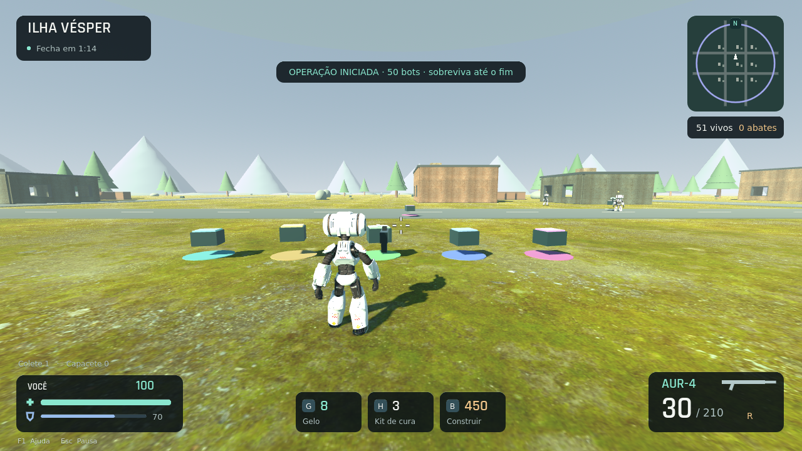

# Aurora Royale — Alpha 0.1

## Downloads

- [Baixar jogo para Windows (87 MB)](https://github.com/jpnait220-star/chatgpt-astra-repositorio/raw/refs/heads/aurora-royale-downloads/Aurora-Royale-Windows-0.1.zip)
- [Baixar projeto Godot editável (15 MB)](https://github.com/jpnait220-star/chatgpt-astra-repositorio/raw/refs/heads/aurora-royale-downloads/Aurora-Royale-Godot-0.1.zip)
- [Controles e instruções](Aurora-Royale-Guia.txt)
- [SHA-256](Aurora-Royale-SHA256.txt)

Extraia o ZIP Windows inteiro e abra **AuroraRoyale.exe**. Mantenha AuroraRoyale.pck na mesma pasta. Para editar, importe project.godot na Godot 4.6.3.

Partida offline com **50 bots**, três armas com dano por distância, gelo destruível, paredes/rampas/pisos, zona que fecha, coletes/capacetes, salto de janela, dois jetpacks raros e sons posicionais.

**35 testes integrados passaram** no projeto e no pacote exportado, aberto por runtime independente no Linux. Não foi executado Windows nativo nem medido FPS na RX 580. Esta alpha é um protótipo em desenvolvimento, sem acabamento gráfico de um jogo comercial.

O pacote Windows usa o executável oficial Godot 4.6.3 com o PCK exportado. Os arquivos incluem os créditos e licenças do personagem, texturas, fontes, sons e engine.
