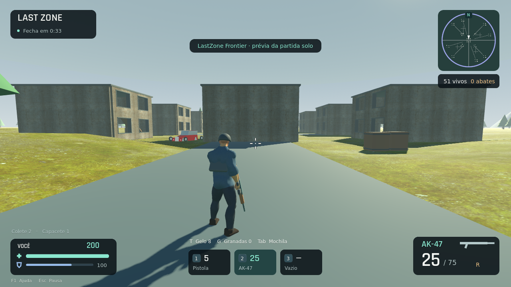
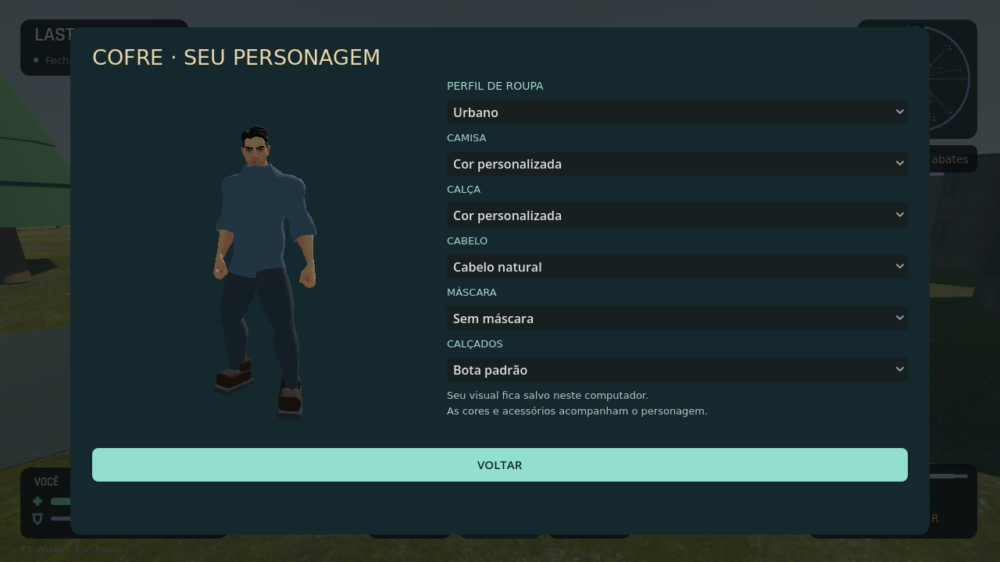

# LastZone Frontier — alpha 0.2

Adaptação solo do LastZone-v6.html em Godot, com o visual base do Aurora e personagem novo animado. O modo Duo ficou de fora por enquanto.

## Downloads

- [Jogo para Windows — 100 MiB](https://github.com/jpnait220-star/chatgpt-astra-repositorio/raw/refs/heads/aurora-royale-downloads/LastZone-Frontier-Windows-0.2.zip)
- [Projeto Godot editável — 43 MiB](https://github.com/jpnait220-star/chatgpt-astra-repositorio/raw/refs/heads/aurora-royale-downloads/LastZone-Frontier-Godot-0.2.zip)
- [Controles e instruções](LastZone-Frontier-Guia.txt)
- [SHA-256 dos ZIPs](LastZone-Frontier-SHA256.txt)

Extraia o ZIP Windows inteiro e abra **LastZoneFrontier.exe**. Mantenha o PCK ao lado do executável. Para editar, importe project.godot na Godot 4.6.3.

50 bots, sete armas do HTML, movimento e câmera adaptados do HTML sem recoil que eleva a mira, cofre/inventário/mapa, carros e motos, gelo curvo com rachaduras, granadas, coletes/capacetes e jetpack raro. As faces do chão, espessura das estradas, textura/recorte da roupa e encaixe das botas foram revisados nas capturas reais.

**55 verificações passaram** no projeto e no PCK exportado, usando runtime independente no Linux. Não foi executado Windows nativo, medido desempenho na RX 580 ou feita audição física dos sons. Esta alpha é um protótipo; o README e docs/VALIDACAO.md dentro dos ZIPs detalham o que foi portado, testes, licenças e limitações conhecidas.

## Versão anterior preservada

- [Aurora Royale 0.1 — Windows](https://github.com/jpnait220-star/chatgpt-astra-repositorio/raw/refs/heads/aurora-royale-downloads/Aurora-Royale-Windows-0.1.zip)
- [Aurora Royale 0.1 — Godot](https://github.com/jpnait220-star/chatgpt-astra-repositorio/raw/refs/heads/aurora-royale-downloads/Aurora-Royale-Godot-0.1.zip)
- [Guia anterior](Aurora-Royale-Guia.txt)
