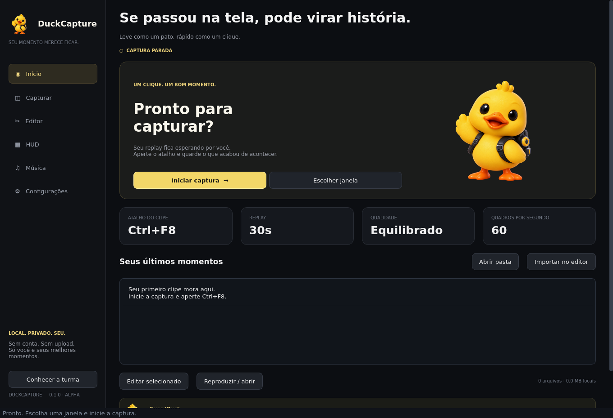
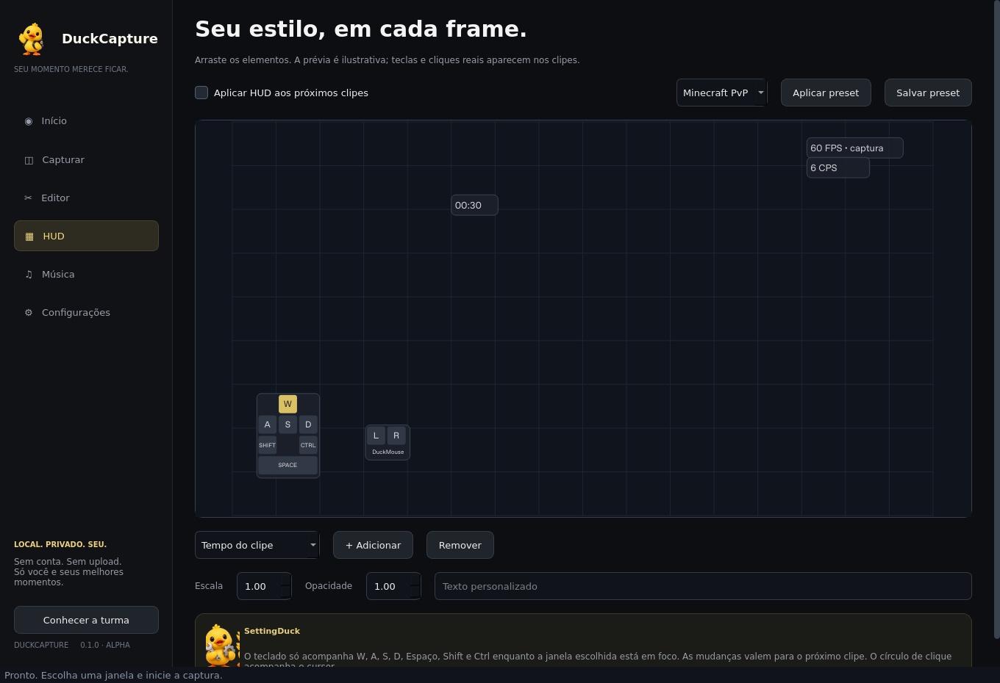

# DuckCapture

Um aplicativo de clipes para Windows, com visual escuro, detalhes amarelos e uma turma de patinhos.

**[Baixar DuckCapture 0.1.0 — ZIP](https://github.com/jpnait220-star/chatgpt-astra-repositorio/raw/refs/heads/asasa/downloads/DuckCapture-0.1.0.zip)**

Instale Python 3.12 de 64 bits, extraia a pasta, execute **Instalar.cmd** e depois **Iniciar DuckCapture.cmd**. Tudo é gratuito. [Instruções completas](LEIA-ME.md).

- Replay de uma janela: 15, 30, 60, 90 ou 120 segundos; clipe e print com atalhos configuráveis.
- Perfis Econômico, Equilibrado, Alta qualidade e Full; seleção de FPS e codificador.
- Editor com trechos, cortes, divisão, união, velocidade, volume, texto, sticker, filtros, zoom e exportação MP4.
- Editor de HUD com elementos arrastáveis, teclas, mouse, cliques, texto, imagens, música e presets.
- Tocador de músicas locais com vinil animado e link de playlist do Spotify.
- Arquivos locais e dicas opcionais de nove mascotes.

**Versão alpha:** interface e processamento de vídeos testados no Linux; captura real, áudio do Windows, atalhos globais e desempenho de GPU ainda precisam de validação no Windows. Não é um instalador independente: utiliza Python e FFmpeg. [Resultados e limites](VALIDACAO.md).

[Conceito organizado](CONCEITO.md) · [Componentes utilizados](THIRD-PARTY.md)
